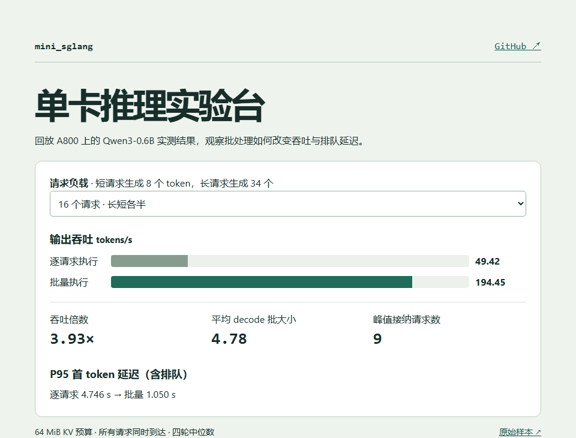

# mini_sglang

**一张 GPU 怎样同时给多个请求生成回答？** 这个小型推理引擎用 Qwen3-0.6B 演示分页 KV cache、Triton attention 和变长批量 decode。你可以读到从权重加载到请求补位的完整路径，也可以先用浏览器比较五种负载。

**[打开交互演示 ↗](https://ililyiv0414-source.github.io/mini_sglang/demo/)** · [实验与 GPU 复现](docs/benchmarks.md) · [English overview](#english-overview)

[](https://ililyiv0414-source.github.io/mini_sglang/demo/)

## 先试一下

1. 打开上面的演示，选择 **16 个请求 · 长短各半**。
2. 比较逐请求与批量执行的输出吞吐和 P95 首 token 延迟。
3. 切换到 **4 个请求**，观察吞吐仍然提高、首 token 延迟却几乎相同。

演示在浏览器回放已提交的 A800 实测数据，无需 GPU、Python 或模型下载。离线使用时，克隆仓库后双击 `docs/demo/index.html`。也可在仓库根目录运行以下命令，用 Docker 在本机提供同一演示：

```bash
docker build -t mini-sglang-demo docs/demo
docker run --rm -p 127.0.0.1:8080:80 mini-sglang-demo
```

在浏览器访问 `http://localhost:8080`。实际生成 token 的环境和命令见 [GPU 复现说明](docs/benchmarks.md)。

## 三个实验，三个问题

| 问题 | 同条件对照 | A800 实测 |
|---|---|---|
| 同一份显存能服务几个请求？ | 固定槽位与分页分配，64 MiB KV 预算 | 峰值接纳从 6 到 9 |
| 能省去逐层收集历史 K/V 吗？ | 单请求，1024-token 输入，直接按页读 KV | decode 延迟从 27.05 到 25.75 ms/token |
| 已接纳的请求怎样一起算？ | 16 请求长短各半，两组均采用分页直接读 | 吞吐从 49.42 到 194.45 tokens/s，达到 3.93× |

所有请求同时到达。五组负载、40 个计时样本逐 token 核对了串行参考输出。查看[测量方法与适用范围](docs/benchmarks.md)和[原始数据](artifacts/workload-sweep.json)。

## 按一个请求的生命周期读代码

1. [模型前向](mini_engine/qwen3.py)读取权重，执行 prefill，生成首个 token。
2. [分页缓存](mini_engine/paged_cache.py)维护每个请求的逻辑位置和物理页，[Triton kernel](mini_engine/paged_attention.py)直接从页表指向的位置读取 K/V。
3. [FIFO 调度与批量 decode](scripts/benchmark_paged_refill.py)把活跃请求合批，在请求结束后回收页并接纳下一条。

## English overview

A small single-GPU Qwen3 inference engine for studying paged KV allocation, Triton attention and variable-length batched decoding. On one A800, a 16-request offline workload reached **194.45 output tokens/s** with batched decode versus **49.42** with serial decode using the same paged backend. The browser demo replays measured results and runs locally without dependencies.

[Contributing](CONTRIBUTING.md) · [MIT License](LICENSE) · [Upstream mini-sglang](https://github.com/sgl-project/mini-sglang)
